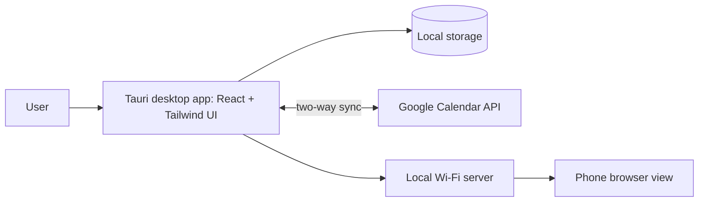

# Deskboard
**A local-first board and planner that lives on your second monitor.** A desktop app for Windows and macOS that started as a tool for myself and is turning into a product.

**Status:** In progress · v0.5.0

> 🔒 **Source code is private.** This repo is a showcase of the product, its features and its architecture.

<!-- screenshot here: board on second monitor -->
<!-- Loom walkthrough here -->

## Who it's for
People with a two-monitor setup who want their notes, tasks and calendar always visible without living in browser tabs.

## Key features
- **Infinite board** for notes, checklists and links
- **Planner** view
- **Two-way Google Calendar sync**
- **Phone view over local Wi-Fi**
- **Local-first**: your data stays on your machine

<!-- screenshot here: planner -->
<!-- screenshot here: phone view -->

## Architecture (high level)

## Stack
Tauri · React · Tailwind · Google Calendar API · Built with Claude Code

## Contact
[brentbuilds.dev@gmail.com](mailto:brentbuilds.dev@gmail.com) · [LinkedIn](https://www.linkedin.com/in/patrick-brent-santiago)
